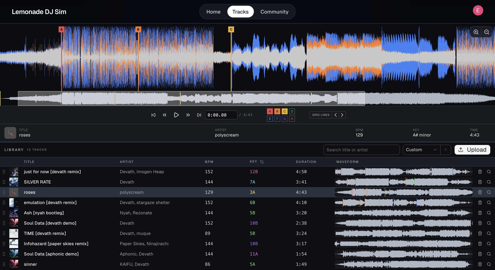
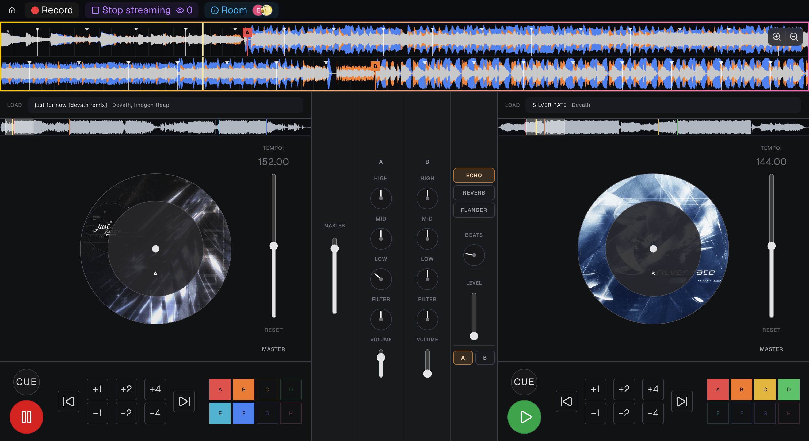
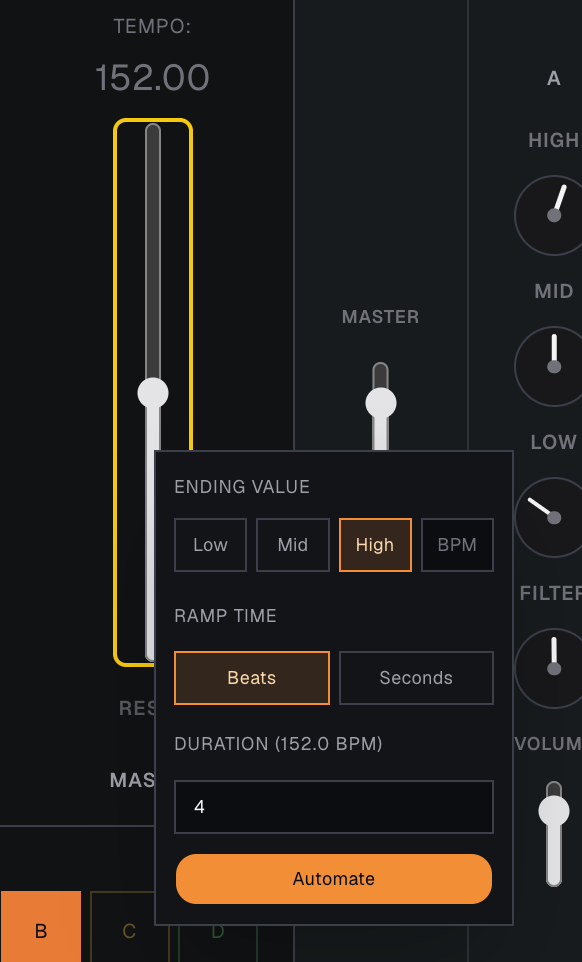

# Multiplayer DJ Simulator

Learn how to DJ. 

Stream your performance to other viewers. 

Collaborate with another user in a 2-player room.

## Gallery

### Tracklist preparation:

### Studio page:

## Technologies

### - **Frontend**: 
  - **React + Vite** - framework
  - **TypeScript** - language
  - **Clerk** - auth
  - **ShadCN** - components
  - **Web Audio API** - audio rendering pipeline
  - **Vercel** - hosting
### - **Backend**: 
  - **Gin** - framework
  - **Go** - language
  - **AWS S3** - user-uploaded audio file storage
  - **AWS Lambda** - audio file analysis (key + BPM finder)
    - **Python** - handler code
    - **Docker** - containerization of handler
    - **Terraform** - infrastructure as code
  - **PostgreSQL** - database (hosted w/ Supabase)
  - **LiveKit** - WebRTC audio streaming
  - **Render** - hosting
  - **GitHub Actions** - CI/CD 
    - *terraform plan* on PR, 
    - *terraform apply* on merge to main

## Cool Features / Challenges

### Streaming:

Used WebSockets to stream the UI state to spectators, such as the DJ's cursor and control events (slider / knob adjustments). Audio is streamed live using WebRTC (LiveKit).

### Collaboration / Rooms:

Implementing real-time collaboration where **exact sync** is required is pretty challenging. If one song is playing just 50ms ahead of the other due to network delay, that's very noticeable. I had to implement an assortment of lag compensation techniques and figure out how to replicate state across both users.

Used in-memory maps to store room state in Go backend, including which DJ currently "owns" which control. Storing ownership prevents 2 users from simultaneously adjusting the same knob or slider. 

Latency (sometimes up to 400ms) is compensated for by smoothly interpolating and extrapolating the UI and audio playback. 
- If User A begins turning a knob, and then User B turns that same knob, the client will optimistically let User B handle the knob until it receives the ground truth ("User A owns the knob") from the server. User B will get kicked off and User A's adjustments are relayed.
- If User A resumes playback, User B will receive this ~200ms later. User B will then compensate by smoothly ramping their audio playback 200ms forward so that both user's will hear identical playback.

### Controls:

DJ'ing is a 2-handed activity. How does this translate to a keyboard and mouse?

Simple drag controls aren't enough, since you can only adjust one thing at a time. Therefore, I added 2 new innovations:

#### Multiselect:
Hold down CMD to select multiple knobs / sliders at once. Now you can move all of them simultaneously. Then, you can optionally hold down SHIFT to *invert* the direction of all other knobs/sliders except the one you're currently controlling. This makes crossfading possible - you can turn one knob clockwise and the other one counter-clockwise simultaneously.

#### Automation:
Right click a knob or slider. You'll get a pop-up that lets you program it. It will then ramp to a specified value in a specified amount of time in the background. This lets you automate tempo/volume changes while keeping your hands free to control other knobs.

### Infrastructure as Code:

This was my first application of "Infrastructure as Code"!

I have an AWS Lambda function that analyzes user-submitted tracks to find BPM, musical key, and grid alignments. I found messing around on AWS to be tiresome, and wanted to codify the state AND automate it in my CI/CD pipeline. So, I utilized Terraform.
- *terraform plan* is run on PR so I can visually observe changes to AWS infra
- *terraform apply* is run on merge to main to apply those changes

## What's next

### Programmable skills
This feature will let you define predefined macros consisting of a sequence of knob/slider adjustments and automations. You would be able to map it to a keybind, and invoke it in future studio sessions. 

### 3-player
Want to run a b2b2b? I plan on adding support for 3-player rooms, though it'll be a bit hectic.

### More CDJs
Currently you only have 2 CDJs, meaning only 2 tracks can play at once. Adding 2 more will make b2b's more flexible, but I'll have to figure out how the UI will look.